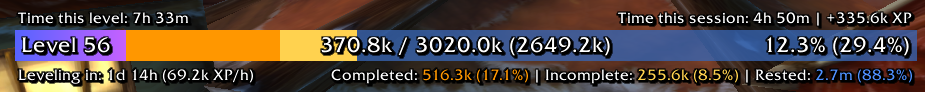

# DrHeals XP Bar (Forever)

An XP bar with rested XP, completed and incomplete quest XP, XP per hour, time to level, and session and played
time. It's DrHeal's aura from wago.io/j4YPGb_k0 (v1.0.2), which was already made for ForeverAuras. It ran on Forever
without errors, but some of its numbers were wrong and it did work every frame.

## Import

Type `/fa`, click Import and paste the contents of `DrHealsXPBar_Forever.txt`. If you already imported the Wago
version, this updates it in place, since it keeps the same uid. Move the bar in `/fa`, because right-drag moving is
gone.

## Changes

- **Quest XP totals.** The original read each quest's objectives and XP from whichever quest was selected in your
  quest log. On Forever that's the last quest you clicked, so every quest counted as done or as open depending on that
  one. Now each quest is read by its own ID.
- **Collapsed headers.** Quests under a collapsed header in the quest log were skipped. Now they keep counting once
  the bar has seen them.
- **XP per hour after a level-up.** Depending on the order the game sent its events, a level-up could add a whole
  level of XP to the session. XP now counts between XP updates only.
- **Every-frame work.** A frame ran code every frame to update the clock texts twice a second, and it could keep
  running after you deleted the aura with `/fa` open. A 1 second timer does it now. It stops when the bar hides or
  the aura is gone.
- **Quest log updates.** Each update re-read and redrew everything. Now it marks the quest XP for a rescan on the
  next tick.
- **Hover menu.** The Reset and Pause halves polled the mouse 10 times a second while open. Now they check once when
  the mouse leaves.
- **Right-drag moving is gone.** Once you dragged the bar, it ignored the position you set in `/fa`.
- **Two options are gone.** Quest XP Source did nothing useful on Forever, which only has the modern quest log.
  Realm XP Multiplier was for private servers.

## Known limits

- With Show Played Time on, the game prints your played time in chat at each login, `/reload` and level-up.
  ForeverAuras blocks aura code from touching the chat frame, so the aura can't hide those lines. Turn the option
  off if they bother you.
- Hide Blizzard XP Bar also hides the reputation bar. Neither comes back after you delete the aura until you
  `/reload`.
- A quest you've never seen with its header open isn't counted until you open that header once.

## Files

| File | What it is |
|---|---|
| `build.py` | Rebuilds the aura from `source/wago_v1.0.2.lua` with `init.lua` as its On Init |
| `init.lua` | The fixed On Init. `diff source/init_original.lua init.lua` shows every change |
| `test.mjs` | 735 checks of the code against a mocked Forever client, and of the data |
| `break_cases.json` | Broken copies that the tests have to catch (`npm run break`) |
| `xpbar_forever.lua` | The built data |
| `DrHealsXPBar_Forever.txt` | The import string |
| `source/wago_v1.0.2.txt` | The import string from Wago |
| `source/wago_v1.0.2.lua` | The same, decoded with `tools/decode.mjs` |
| `source/init_original.lua` | DrHeal's On Init |
| `source/wago_preview.png` | DrHeal's screenshot from Wago |
