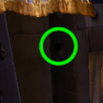

# Ultimate Mouse Cursor (Forever)

A cursor reticle for WoW Forever. It puts a black dot on the click point inside a thin ring, green out of combat and
magenta in combat, with rings for the GCD, casts, latency and the swing timer. It's ported from sarthe's Classic aura at
wago.io/GpGl-Yvr7, and I checked it in game on Nov 8, 2026.

## Import

1. Type `/fa`, click Import and paste the contents of `UltimateMouseCursor_Forever.txt`.
2. If an older copy is installed, delete the "Ultimate Mouse Cursor (Forever)" group first, or tick "Size & Position"
   in the update window. A plain update keeps the old sizes.

## Options

They're in the group's Custom Options tab:

- hide on right click
- show only while holding Left Alt, Shift or Ctrl
- hide Blizzard's cast bar (`/reload` after turning it off to get the bar back)
- show casts as a ring or as a small bar under the pointer
- show the swing timer ring

## Changes from the Classic aura

- Same look and size on screen. The group follows the cursor at half scale, and the dot rescales it for Forever's UI
  scale, because Classic ran at 0.7.
- Visibility runs on mouse and key events. The Classic aura checked it every frame in every part. A 0.2 second check
  runs only while the show-on-key-press key is held, to catch a release lost to alt-tab.
- The GCD ring runs on cooldown events and uses the game's timer object when combat hides the times.
- The swing ring uses the Swing Timer trigger. The Classic copy had a Health trigger.
- The latency wedges use your ping and update on cast events.
- Fixed from the original: colors set to 255 that turned parts white, the channel latency wedge sitting 11 pixels off
  center, anchors pointing at an aura that doesn't exist, and a key-press check that stopped after 50 seconds.

## Files

| File | What it is |
|---|---|
| `build.py` | Rebuilds the aura from `source/classic_snapshot.lua` |
| `test.mjs` | 1,627 checks of the custom code and the data, against mocked game functions |
| `break_tests.py` | Breaks copies on purpose and checks the tests catch each one |
| `cursor_forever.lua` | The built data, which `test.mjs` and the encoder read |
| `UltimateMouseCursor_Forever.txt` | The import string (6,345 characters) |
| `source/classic_snapshot.lua` | The Classic aura as saved in Anniversary on Aug 28, 2026 |
| `source/wago_preview.png` | sarthe's preview image from Wago |

## Not done

Hiding the system pointer. Ultimate Mouse Cursor never did it either. LESSONS.md has the one lead, a trick from the
CursorForge addon that hasn't been tested.
